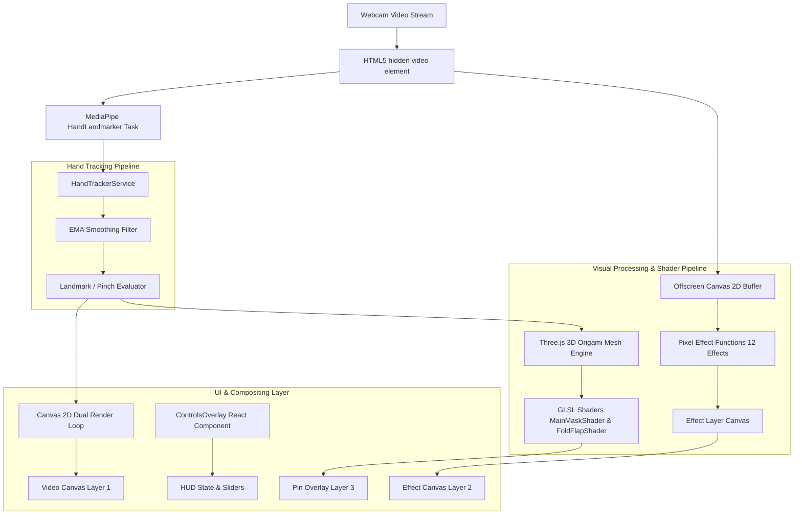
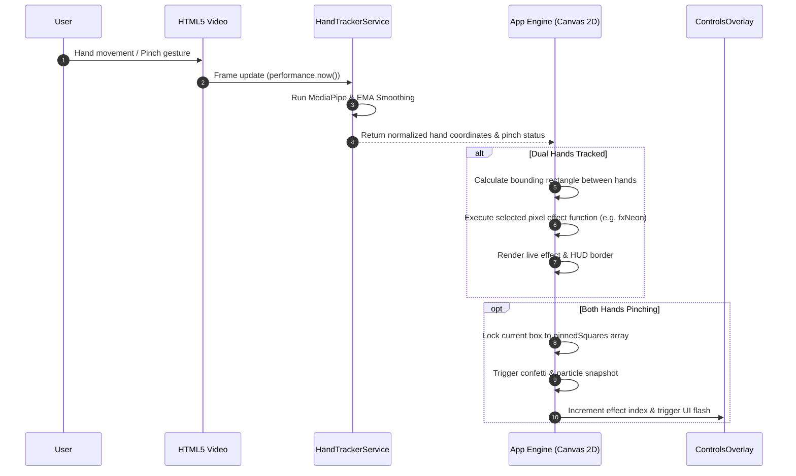

# GestureLens System Architecture 📐✨

> **Architecture and Technical Design Document for GestureLens**

This document provides a comprehensive overview of the system architecture, component relationships, data flow pipelines, tracking mechanisms, rendering loops, and custom shader pipelines used in **GestureLens**.

---

## 1. High-Level Architecture Overview

GestureLens operates on a multi-tiered pipeline: video frame acquisition, AI hand landmark tracking, geometric spatial mapping, visual filter manipulation, and layered HTML5 Canvas / Three.js compositing.



---

## 2. Directory Structure & Key Modules

| Module / Path | Description |
|---|---|
| [App.jsx](file:///e:/hand-mask-mediapipe/src/App.jsx) | Core application entry, canvas layering engine, 12 pixel filter functions, and animation frame detection loop. |
| [handTracker.js](file:///e:/hand-mask-mediapipe/src/services/handTracker.js) | Encapsulated MediaPipe `HandLandmarker` service managing GPU/CPU delegate initialization, landmark parsing, EMA smoothing, and mock telemetry. |
| [risoShaders.js](file:///e:/hand-mask-mediapipe/src/shaders/risoShaders.js) | Custom GLSL shaders (`MainMaskShader`, `FoldFlapShader`) driving Riso Pop-Art, Blue Xerox, Halftone, and Thermal visual effects. |
| [ControlsOverlay.jsx](file:///e:/hand-mask-mediapipe/src/components/ControlsOverlay.jsx) | React Glassmorphism HUD component managing user settings, fold geometry options, contrast/dot scale parameters, and snapshot triggers. |

---

## 3. Data Flow & Detection Pipeline

### 3.1 Hand Tracking & Exponential Moving Average (EMA)
1. **Webcam Capture**: HTML5 `navigator.mediaDevices.getUserMedia` captures raw 1280x720 video frames.
2. **MediaPipe Vision Engine**: `@mediapipe/tasks-vision` processes the video frame using the `float16` `hand_landmarker.task` model.
3. **EMA Smoothing**: To eliminate jitter, landmark positions (specifically Index Tip `#8` and Thumb Tip `#4`) are smoothed frame-by-frame:
   $$\text{smoothed}_{t} = \text{smoothed}_{t-1} + \alpha \cdot (\text{raw}_{t} - \text{smoothed}_{t-1}) \quad (\alpha = 0.1 \text{ to } 0.35)$$
4. **Pinch Detection**:
   $$\text{distance} = \sqrt{(x_{\text{index}} - x_{\text{thumb}})^2 + (y_{\text{index}} - y_{\text{thumb}})^2}$$
   If $\text{distance} < 0.035$ normalized units, a pinch gesture is registered.

### 3.2 Canvas Layering Strategy
GestureLens utilizes a multi-layered DOM canvas technique to achieve high performance without unnecessary re-renders:

```
[Layer 3 - Z-Index 3] Pin Canvas (Redrawn on pinch/snap lock event)
[Layer 2 - Z-Index 2] Effect Canvas (Redrawn every frame for pixel effects)
[Layer 1 - Z-Index 1] Video Canvas (Mirrored camera feed + live fingertips + live border)
```

---

## 4. Visual Filter & Shader Engine

### 4.1 Canvas 2D Pixel Effects (`App.jsx`)
Each frame, video pixels enclosed inside hand boundaries are extracted via `offscreenCtx.getImageData()` and modified in-place before rendering via `putImageData()`:

* **Sobel Edge Detection (Neon / Comic)**: Computes image gradients $G_x$ and $G_y$ using Sobel kernels:
  $$G_x = \begin{bmatrix} -1 & 0 & 1 \\ -2 & 0 & 2 \\ -1 & 0 & 1 \end{bmatrix}, \quad G_y = \begin{bmatrix} -1 & -2 & -1 \\ 0 & 0 & 0 \\ 1 & 2 & 1 \end{bmatrix}$$
* **Hologram**: Modulates vertical scanlines $y \pmod 4$ with sine wave displacement $\sin(y \cdot 0.25) \cdot 4$.
* **Duotone**: Maps luminance $L = 0.299R + 0.587G + 0.114B$ linearly between a dark purple baseline `[20, 0, 80]` and bright yellow highlight `[255, 210, 0]`.

### 4.2 Three.js GLSL Shaders (`risoShaders.js`)
* **`MainMaskShader`**: Applies screen UV coordinates (`vScreenUv = clip.xy / clip.w * 0.5 + 0.5`) to create an X-Ray window effect over 3D folded geometry.
* **`FoldFlapShader`**: Renders dynamic halftone dot grids or diagonal hazard stripes on origami fold flaps.

---

## 5. Sequence Diagram: Hand Detection & Pinning Loop



---

## 6. Performance Optimization Techniques

1. **GPU Acceleration**: MediaPipe initialization automatically tries `GPU` delegate first, falling back to `CPU` if WebGL delegate creation fails.
2. **Offscreen Canvas Buffering**: Reading image data from an offscreen 2D canvas context set to `{ willReadFrequently: true }` avoids WebGL context readback stalls.
3. **Layer Separation**: Unchanged pin borders are kept on a static canvas layer (`pinCanvasRef`) so only the active mask box is reprocessed every frame.
